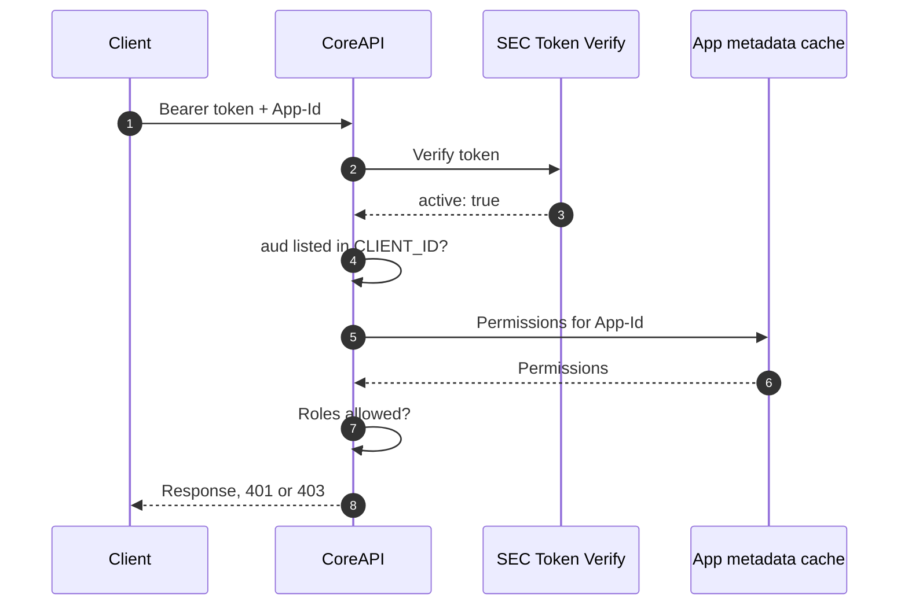

# SEC Token Verification and Supported Client IDs

PlanetHCSC is integrating DeliA capabilities into its mobile app. The app signs users in through PlanetHCSC's own ForgeRock client and calls CoreAPI with the resulting access token. CoreAPI rejects these calls even though the tokens are valid. This document explains why and proposes the fix.

## Background

Two checks in CoreAPI blocked PlanetHCSC's tokens. The first is fixed; this proposal covers the second.

| Check | Why Planet tokens failed | Status |
| --- | --- | --- |
| Issuer | CoreAPI kept a hard-coded issuer list, and Planet's issuer (`auth-uat.hcsctest.net`) was not on it. | Fixed: CoreAPI now verifies every token through SEC Token Verify. |
| Audience | CoreAPI accepts only tokens whose `aud` equals DeliA's client ID. | Proposed: let `CLIENT_ID` hold a list of accepted client IDs. |

## Why the audience check fails

With SEC in place, Planet tokens pass verification but are still rejected by CoreAPI with `401 Audience doesn't match`.

In HCSC's ForgeRock, a token's `aud` claim is the client ID of the app that requested it. CoreAPI compares `aud` with a single global `CLIENT_ID`, which is DeliA's. So only DeliA tokens can pass:

| Token from | Token `aud` | CoreAPI expects | Result |
| --- | --- | --- | --- |
| DeliA | DeliA's client ID | DeliA's client ID (`CLIENT_ID`) | Accepted |
| PlanetHCSC | `a23afbdbec3c46cfa573483eeaf5ad27` | DeliA's client ID (`CLIENT_ID`) | 401 Audience doesn't match |

The token is genuine; it was simply issued to a different client. The fix is to tell CoreAPI which other client IDs it should accept.

## Simple sequence diagram

Every authenticated request to CoreAPI goes through three checks. Steps 1 to 3 below follow the diagram.

| Step | Status |
| --- | --- |
| 1. SEC Token Verify | Already agreed and implemented |
| 2. Check the audience | **Changed**: `aud` may be any client ID listed in `CLIENT_ID` |
| 3. Check the user's roles | Unchanged |



## 1. SEC Token Verify checks the token

CoreAPI does not hold ForgeRock's public keys, so it cannot prove a token is genuine by decoding it. It sends the token to SEC Token Verify (v6) instead.

| SEC checks | Meaning |
| --- | --- |
| Signature | ForgeRock signed the token and nobody changed it. |
| Signing algorithm | The token uses an allowed algorithm. |
| Issuer (`iss`) | The token came from a ForgeRock issuer HCSC trusts. |
| Expiry (`exp`) | The token has not expired. |

CoreAPI continues only on HTTP 200 with `active: true`. Anything else (`active: false`, a non-200 status, a timeout or an unreadable response) is rejected with 401.

**This is what fixed the original issue.** CoreAPI no longer keeps its own list of issuers, so Planet's issuer (`auth-uat.hcsctest.net`) is accepted because SEC trusts it. SEC does not check the audience, which is why step 2 is needed.

## 2. CoreAPI checks the audience

CoreAPI accepts the token if its `aud` is any of the client IDs listed in `CLIENT_ID`.

| | Before | After |
| --- | --- | --- |
| Accepted `aud` | DeliA's client ID only | Any client ID listed in `CLIENT_ID` |
| DeliA token | Accepted | Accepted |
| PlanetHCSC token | Rejected: `401 Audience doesn't match` | Accepted |
| Token from an unlisted client | Rejected | Rejected |

The allowed list comes from CoreAPI's own configuration, never from the request. CoreAPI logs the token's `client_id`, so each caller can still be identified. The existing STS audience exception is unchanged.

## 3. CoreAPI checks the user's roles

This step is unchanged. CoreAPI reads the user's roles from the token and compares them with the permissions in the app's metadata for the requested path and method.

| Token type | Roles read from |
| --- | --- |
| PKCE (user login) | `roles` |
| STS | `hcsc_private_claims.roles` |

A valid token whose roles do not allow the request receives 403. PlanetHCSC calls with DeliA's `App-Id`, so its users are checked against DeliA's permissions and need the same roles as DeliA users, such as `IDP_DELIA_USER`.

## Configuration change

`CLIENT_ID` changes from one client ID to a comma-separated list. A single value still works, so environments that do not need PlanetHCSC stay as they are.

```
CLIENT_ID=<delia-client-id>,a23afbdbec3c46cfa573483eeaf5ad27
```

| Variable | Before | After |
| --- | --- | --- |
| `CLIENT_ID` | DeliA's client ID | DeliA's client ID plus any other accepted client IDs, comma-separated. These are identifiers, not secrets. |

CoreAPI splits the value into a list and passes it to the audience check:

```python
allowed = [c.strip() for c in settings.CLIENT_ID.split(",") if c.strip()]
claims = jwt.decode(token, options=options, audience=allowed)
```

To onboard a new client:

1. Append its client ID to `CLIENT_ID` in each environment. Dev, UAT and prod client IDs differ.
2. Redeploy or restart CoreAPI.
3. Call CoreAPI with a token issued for that client.

Removing a client ID and restarting stops that client's tokens from being accepted.

## Sample flow

A PlanetHCSC request in UAT, in call order. Tokens are shortened; user details are replaced with placeholders.

### Step 1 — Planet calls CoreAPI

- **URL:** `https://<coreapi-host>/<endpoint>`
- **Headers:** `Authorization: Bearer eyJ0eXAiOiJKV1Qi...` and `App-Id: <delia-app-id>`

The token's relevant claims, decoded:

```json
{
  "iss": "https://auth-uat.hcsctest.net:443/sso/oauth2/realms/root/realms/employees",
  "aud": "a23afbdbec3c46cfa573483eeaf5ad27",
  "client_id": "a23afbdbec3c46cfa573483eeaf5ad27",
  "scope": ["openid", "profile"],
  "roles": "basicuser;IDP_DELIA_USER",
  "sub": "<user-id>"
}
```

### Step 2 — CoreAPI verifies the token with SEC

- **URL:** `https://t-stv-ig-uat-svc.test.hcscint.net/v6/sec-token-verify`
- **Method:** `POST`, form-encoded
- **Body:** `token=eyJ0eXAiOiJKV1Qi...` (no `Bearer` prefix)

Response (abbreviated):

```json
{
  "active": true,
  "verify_results": "success",
  "iss": "https://auth-uat.hcsctest.net:443/sso/oauth2/realms/root/realms/employees",
  "client_id": "a23afbdbec3c46cfa573483eeaf5ad27"
}
```

### Step 3 — CoreAPI checks audience and roles

| Check | Token | Expected | Result |
| --- | --- | --- | --- |
| Audience | `aud` = `a23afbdb...` | Listed in `CLIENT_ID` | Pass |
| Roles | `basicuser`, `IDP_DELIA_USER` | DeliA's permissions for the path and method | Pass or 403 |

### Before this change

The same request passed SEC but failed at the audience check, because `aud` was compared with DeliA's client ID only:

```json
{
  "message": "JWT token validation failed: Audience doesn't match",
  "success": false,
  "data": {}
}
```
