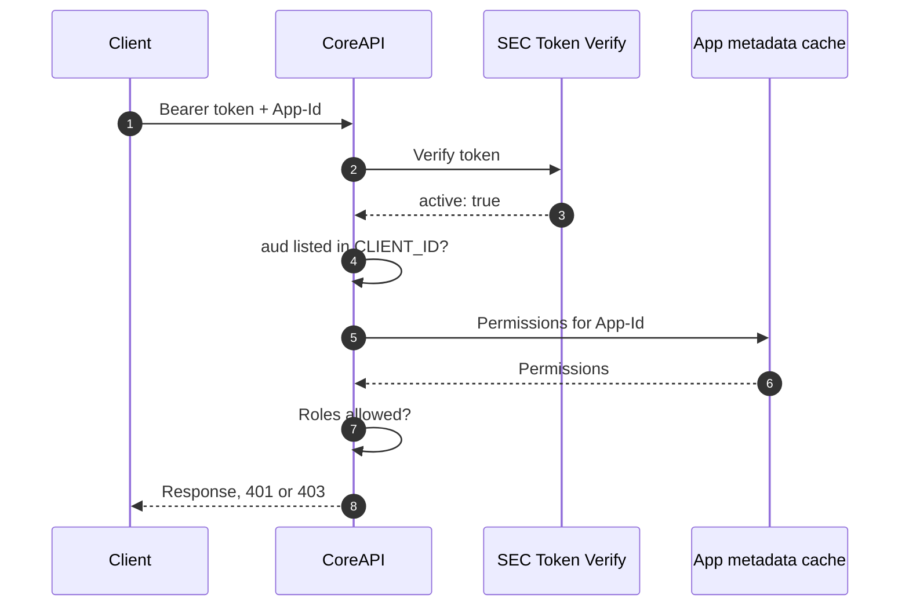

# SEC Token Verification and Supported Client IDs

PlanetHCSC is integrating DeliA capabilities into its mobile app. The app signs users in through PlanetHCSC's own ForgeRock client and calls CoreAPI with the resulting access token. CoreAPI rejected these calls even though the tokens are valid.

Two separate checks in CoreAPI caused this. They were found one after the other: fixing the first exposed the second.

| # | Problem | Fix | Status |
| --- | --- | --- | --- |
| 1 | CoreAPI did not trust Planet's token issuer | Verify tokens through SEC Token Verify | Proposed |
| 2 | CoreAPI accepts only DeliA's client ID as the token audience | Let `CLIENT_ID` hold a list of accepted client IDs | Proposed |

## Problem 1: CoreAPI did not trust Planet's issuer

### What happened

CoreAPI checked each token's issuer (`iss`) against a hard-coded list in `auth/idp-common`. Planet's tokens come from a different ForgeRock hostname for the same `employees` realm, so they were rejected before anything else was checked.

| Token from | Issuer (`iss`) | In CoreAPI's list? |
| --- | --- | --- |
| DeliA | `https://auth-uat.test.fyiblue.com:443/sso/oauth2/realms/root/realms/employees` | Yes |
| PlanetHCSC | `https://auth-uat.hcsctest.net:443/sso/oauth2/realms/root/realms/employees` | No |

```
InvalidIssuerError: Token issuer 'https://auth-uat.hcsctest.net:443/...' not in allowed issuers
```

### Fix: SEC Token Verify

As recommended, CoreAPI stops keeping its own issuer list and sends every token to SEC Token Verify (v6), the central HCSC service that knows all trusted issuers.

| SEC checks | Meaning |
| --- | --- |
| Signature | ForgeRock signed the token and nobody changed it. |
| Signing algorithm | The token uses an allowed algorithm. |
| Issuer (`iss`) | The token came from a ForgeRock issuer HCSC trusts. |
| Expiry (`exp`) | The token has not expired. |

CoreAPI continues only on HTTP 200 with `active: true`. Anything else (`active: false`, a non-200 status, a timeout or an unreadable response) is rejected with 401.

Sample call with a Planet token in UAT:

- **URL:** `https://t-stv-ig-uat-svc.test.hcscint.net/v6/sec-token-verify`
- **Method:** `POST`, form-encoded
- **Body:** `token=eyJ0eXAiOiJKV1Qi...` (no `Bearer` prefix)

```json
{
  "active": true,
  "verify_results": "success",
  "iss": "https://auth-uat.hcsctest.net:443/sso/oauth2/realms/root/realms/employees",
  "client_id": "a23afbdbec3c46cfa573483eeaf5ad27"
}
```

**Result:** In testing, Planet's token passes SEC, so this fix resolves the issuer problem. SEC does not check the token's audience, which led to the second problem.

## Problem 2: CoreAPI accepts only DeliA's client ID

### What happened

After SEC accepts a token, CoreAPI decodes it and checks its audience (`aud`). In HCSC's ForgeRock, `aud` is the client ID of the app that requested the token. CoreAPI compares it with a single `CLIENT_ID` setting, which holds DeliA's client ID, so only DeliA's own tokens pass.

| Token from | Token `aud` | CoreAPI expects | Result |
| --- | --- | --- | --- |
| DeliA | DeliA's client ID | DeliA's client ID | Accepted |
| PlanetHCSC | `a23afbdbec3c46cfa573483eeaf5ad27` | DeliA's client ID | Rejected |

The relevant claims from Planet's token:

```json
{
  "iss": "https://auth-uat.hcsctest.net:443/sso/oauth2/realms/root/realms/employees",
  "aud": "a23afbdbec3c46cfa573483eeaf5ad27",
  "client_id": "a23afbdbec3c46cfa573483eeaf5ad27",
  "roles": "basicuser;IDP_DELIA_USER",
  "sub": "<user-id>"
}
```

CoreAPI's response:

```json
{
  "message": "JWT token validation failed: Audience doesn't match",
  "success": false,
  "data": {}
}
```

The token is genuine; it was issued to a different client.

### Fix: let `CLIENT_ID` hold a list

`CLIENT_ID` is used only for this audience check, so it can hold a comma-separated list of accepted client IDs. A single value still works, so environments that do not need PlanetHCSC stay as they are.

```
CLIENT_ID=<delia-client-id>,a23afbdbec3c46cfa573483eeaf5ad27
```

CoreAPI splits the value into a list and passes it to the audience check:

```python
allowed = [c.strip() for c in settings.CLIENT_ID.split(",") if c.strip()]
claims = jwt.decode(token, options=options, audience=allowed)
```

| | Before | After |
| --- | --- | --- |
| Accepted `aud` | DeliA's client ID only | Any client ID listed in `CLIENT_ID` |
| DeliA token | Accepted | Accepted |
| PlanetHCSC token | Rejected: `401 Audience doesn't match` | Accepted |
| Token from an unlisted client | Rejected | Rejected |

The list comes from CoreAPI's own configuration, never from the request. CoreAPI logs the token's `client_id`, so each caller can still be identified. These client IDs are identifiers, not secrets.

To onboard a new client:

1. Append its client ID to `CLIENT_ID` in each environment. Dev, UAT and prod client IDs differ.
2. Redeploy or restart CoreAPI.
3. Call CoreAPI with a token issued for that client.

Removing a client ID and restarting stops that client's tokens from being accepted.

## End-to-end flow

With both fixes, every authenticated request to CoreAPI goes through three checks.

| Step | Check | Status |
| --- | --- | --- |
| 1 | SEC Token Verify: signature, issuer, expiry | Fix for problem 1 (proposed) |
| 2 | Audience: `aud` listed in `CLIENT_ID` | Fix for problem 2 (proposed) |
| 3 | Roles against the app's permissions | Unchanged |



Step 3 is unchanged. CoreAPI reads the user's roles from the token (`roles` for PKCE tokens, `hcsc_private_claims.roles` for STS tokens) and compares them with the app's permissions for the requested path and method. A valid token without the required role receives 403. PlanetHCSC calls with DeliA's `App-Id`, so its users are checked against DeliA's permissions and need the same roles as DeliA users, such as `IDP_DELIA_USER`.

## Sample flow

A PlanetHCSC request in UAT with both fixes in place, in call order. Tokens are shortened; user details are replaced with placeholders.

### Step 1 — Planet calls CoreAPI

- **URL:** `https://<coreapi-host>/<endpoint>`
- **Headers:** `Authorization: Bearer eyJ0eXAiOiJKV1Qi...` and `App-Id: <delia-app-id>`

### Step 2 — CoreAPI verifies the token with SEC

- **URL:** `https://t-stv-ig-uat-svc.test.hcscint.net/v6/sec-token-verify`
- **Method:** `POST`, form-encoded
- **Body:** `token=eyJ0eXAiOiJKV1Qi...`

```json
{
  "active": true,
  "verify_results": "success",
  "iss": "https://auth-uat.hcsctest.net:443/sso/oauth2/realms/root/realms/employees",
  "client_id": "a23afbdbec3c46cfa573483eeaf5ad27"
}
```

`active: true`, so CoreAPI continues.

### Step 3 — CoreAPI checks the audience

```
CLIENT_ID=<delia-client-id>,a23afbdbec3c46cfa573483eeaf5ad27
token aud = a23afbdbec3c46cfa573483eeaf5ad27
```

The token's `aud` is in the list, so CoreAPI continues.

### Step 4 — CoreAPI checks the user's roles

CoreAPI reads the roles from the token and compares them with DeliA's permissions for the requested path and method.

| Token roles | Required by DeliA | Result |
| --- | --- | --- |
| `basicuser`, `IDP_DELIA_USER` | `IDP_DELIA_USER` for this endpoint | Allowed |

### Step 5 — CoreAPI responds

All three checks pass, so CoreAPI returns `200 OK` with the requested data.

| If this check fails | Response |
| --- | --- |
| SEC returns `active: false` | `401 Unauthorized` |
| `aud` not listed in `CLIENT_ID` | `401 Audience doesn't match` |
| Roles don't allow the request | `403 Forbidden` |
