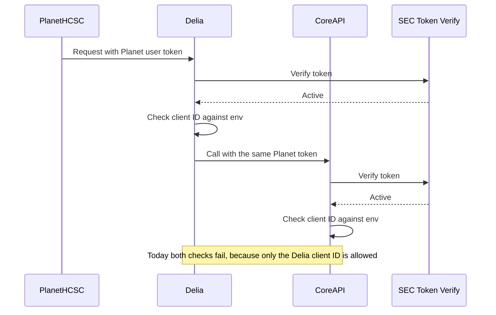

# PlanetHCSC Access to Delia: Token Verification and Client IDs

## Overview

PlanetHCSC wants to connect to Delia. Planet users sign in through Planet's own OAuth client, and Planet passes their token to Delia. Delia then passes the same token on to CoreAPI.

However, Planet's tokens were being rejected even though they were valid.

---

## Issue 1: Planet Tokens Rejected by the Issuer Check

The shared `idp_common` module trusted a token only if its issuer was in a hardcoded local list. Planet's ForgeRock issuer was not on that list, so valid Planet tokens were rejected.

### Fix: SEC Token Verify

Instead of keeping our own issuer list, `idp_common` now sends each token to the SEC Token Verify v6 service.

- SEC decides whether the token's signature and issuer are trusted.
- The token is accepted only if SEC returns HTTP `200` with `active: true`. Otherwise the request gets `401`.

This fixed the issuer problem. Planet tokens now pass SEC verification.

---

## Issue 2: Client ID Check Fails

After the SEC fix, we tested again and found a second issue. Planet tokens now passed SEC, but failed at the next check: the client ID.

Every token carries the client ID of the OAuth client that issued it (the `aud` claim). Each service has one allowed client ID set in its env config, and it rejects any token whose client ID doesn't match.

Delia's backend calls CoreAPI and passes the Planet user's token along. That means both services check Planet's token against their own env value:

| Service | Client ID in env | Planet token's client ID | Result |
| --- | --- | --- | --- |
| Delia | Delia client ID | Planet client ID | `401 Audience doesn't match` |
| CoreAPI | Delia client ID | Planet client ID | `401 Audience doesn't match` |



### Option 1: Extend the client ID list in env

Change the single client ID in env to a list, and add Planet's client ID in both Delia and CoreAPI.

This works, but it doesn't scale:

- Every new consumer needs an env change in both services.
- Both services must be redeployed every time.
- The two lists have to be kept in sync by hand.

### Option 2 (proposed): Client ID mapping in Cosmos

Store the allowed client IDs in a client mapping document in Cosmos, the same way app metadata is stored today. Load it into a cache, and have `idp_common` check the token's client ID against the cached mapping instead of env.

Example document (field names are illustrative):

```json
{
  "id": "CLIENT-MAPPING",
  "documentType": "CLIENT_MAPPING",
  "clients": [
    { "clientId": "<delia-client-id>", "name": "Delia" },
    { "clientId": "<planet-client-id>", "name": "PlanetHCSC" }
  ]
}
```

These values are client IDs, not secrets.

Why this approach:

- **One source of truth.** Delia and CoreAPI both read the same mapping, so the lists can't drift apart.
- **No redeploys.** Adding a consumer means adding an entry in Cosmos and refreshing the cache.
- **Same pattern as app metadata.** It reuses the Cosmos and cache setup we already have.

The env client ID stays as a fallback, so the current behavior continues until the mapping is in place.

### What's needed

1. Create the client mapping document in Cosmos with the Delia and Planet client IDs.
2. Load it into the cache alongside app metadata.
3. Update the client ID check in `idp_common` to use the cached mapping, with the env client ID as a fallback.
4. Refresh the cache, or restart the services, after the mapping changes.
5. Test that a Planet token passes through Delia to CoreAPI, and that a token from an unlisted client is still rejected.
