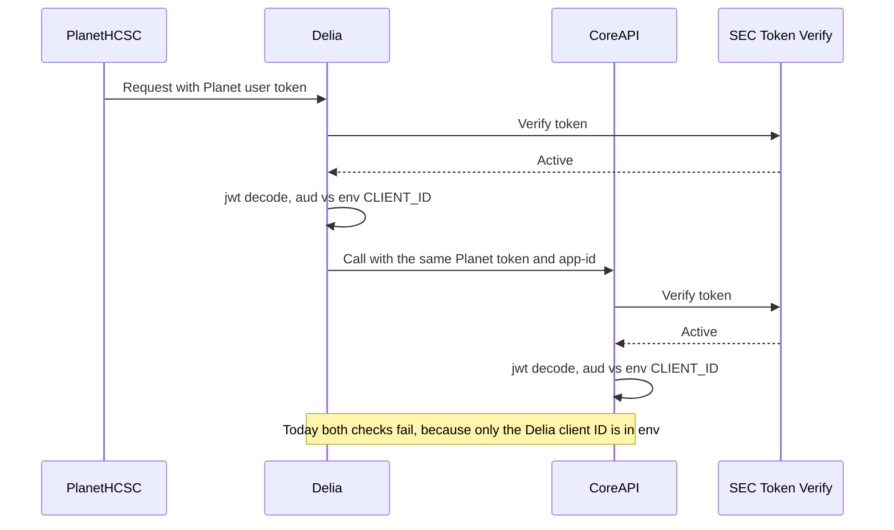
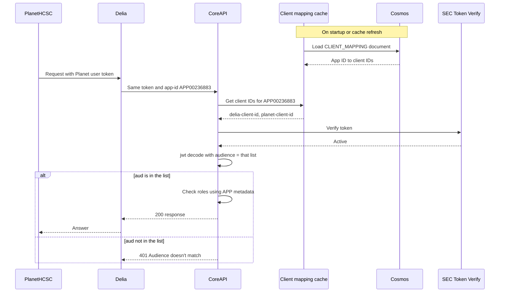
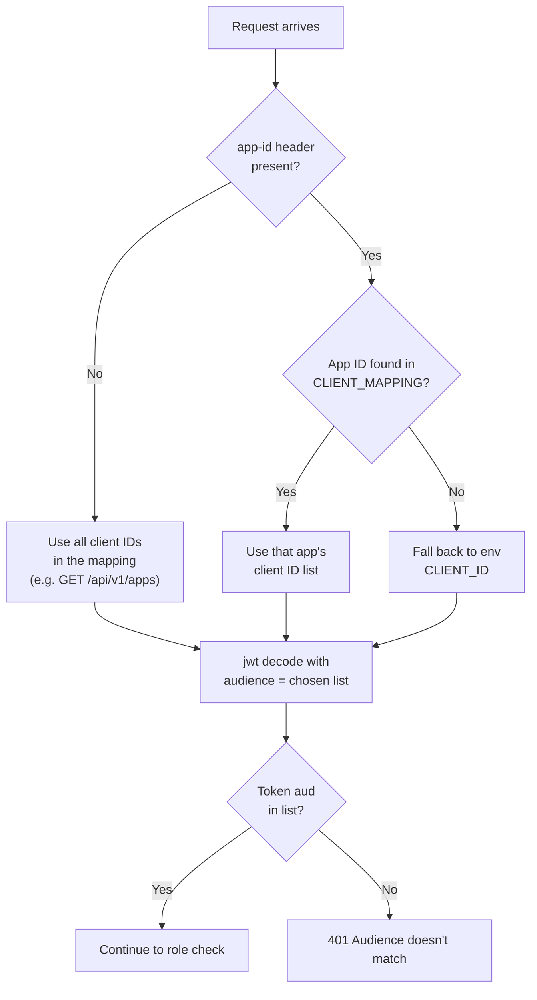

# PlanetHCSC Access to Delia: Token Verification and Client IDs

## Overview

PlanetHCSC wants to connect to Delia. Planet users sign in through Planet's own OAuth client, and Planet passes their token to Delia. Delia then passes the same token on to CoreAPI.

However, Planet's tokens were being rejected even though they were valid.

---

## Issue 1: Planet Tokens Rejected by the Issuer Check

Delia and Planet tokens come from two different ForgeRock issuers:

| App | Token issuer (`iss`) | Scopes |
| --- | --- | --- |
| Delia | `https://auth-uat.test.fyiblue.com:443/sso/oauth2/realms/root/realms/employees` | openid, profile, permission, roles |
| PlanetHCSC | `https://auth-uat.hcsctest.net:443/sso/oauth2/realms/root/realms/employees` | openid, profile |

The shared `idp_common` module trusted a token only if its issuer was in a hardcoded local list. That list had Delia's issuer but not Planet's, so valid Planet tokens were rejected.

### Example

A Planet user calls the Delia API. Their token contains:

```json
{
  "iss": "https://auth-uat.hcsctest.net:443/sso/oauth2/realms/root/realms/employees",
  "aud": "<planet-client-id>"
}
```

1. Delia's `idp_common` reads the token's `iss`.
2. It compares it against the hardcoded issuer list, which only contains `https://auth-uat.test.fyiblue.com:443/sso/oauth2/realms/root/realms/employees`.
3. The Planet issuer (`auth-uat.hcsctest.net`) is not in the list, so the request is rejected with `401`, even though the token is valid.

### Fix: SEC Token Verify

Instead of keeping our own issuer list, `idp_common` now sends each token to the SEC Token Verify v6 service.

- SEC decides whether the token's signature and issuer are trusted. It verifies tokens across all ForgeRock issuers internally, including both the Delia and Planet issuers. See [API Security IDaaS Guide](https://confluence.fyiblue.com/spaces/CS/pages/258837921/API+Security+IDaaS+-+Guide).
- The token is accepted only if SEC returns HTTP `200` with `active: true`. Otherwise the request gets `401`.

This fixed the issuer problem. Planet tokens now pass SEC verification.

---

## Issue 2: Client ID Check Fails

After the SEC fix, we tested again and found a second issue. Planet tokens now passed SEC, but failed at the next check: the client ID.

### Current behavior

Every token carries the client ID of the OAuth client that issued it, in the `aud` claim.

Each app has one client ID configured in its env (`CLIENT_ID`). When a request comes in, CoreAPI's `get_user_context` dependency extracts the token, and `idp_common` decodes the JWT and checks that the token's `aud` matches that env value:

```python
jwt.decode(token, ..., audience=CLIENT_ID)  # single client ID from env
```

If the values don't match, the request is rejected with `401 Audience doesn't match`.

### Why Planet tokens fail

Here is what happens when a Planet user asks a question:

1. The user signs in to PlanetHCSC and gets a token from Planet's OAuth client. The token's `aud` is the Planet client ID.
2. PlanetHCSC calls the Delia API with that token.
3. Delia verifies the token with SEC, then checks its `aud` against Delia's env `CLIENT_ID`.
4. To answer the question, Delia calls CoreAPI and passes the same Planet token along.
5. CoreAPI verifies the token with SEC, then checks its `aud` against CoreAPI's env `CLIENT_ID`.

Delia calls these CoreAPI endpoints:

| CoreAPI endpoint | Purpose |
| --- | --- |
| `POST /api/v1/chatcompletions` | Streaming model responses and question generation |
| `POST /api/v1/aisearch/search` | Retrieve search context |
| `GET /api/v1/eam/access` | Retrieve accessible index information |

Each call sends the user's token and Delia's app ID, which Delia reads from `APP_ID` in its env:

```http
Authorization: Bearer <planet-user-token>
app-id: APP00236883
```

Both Delia and CoreAPI check Planet's token against their own env `CLIENT_ID`:

| Service | `CLIENT_ID` in env | Planet token's `aud` | Result |
| --- | --- | --- | --- |
| Delia | Delia client ID | Planet client ID | `401 Audience doesn't match` |
| CoreAPI | Delia client ID | Planet client ID | `401 Audience doesn't match` |



### Option 1: Extend the client ID list in env

Change the single `CLIENT_ID` in env to a list, and add Planet's client ID in both Delia and CoreAPI.

This works, but it doesn't scale:

- Every new consumer needs an env change in both services.
- Both services must be redeployed every time.
- The two lists have to be kept in sync by hand.

### Option 2 (proposed): Client ID mapping in Cosmos

Store each app's allowed client IDs in a `CLIENT_MAPPING` document in Cosmos, keyed by app ID. CoreAPI loads it into a cache, and `idp_common` checks the token's `aud` against the client IDs for the app in the request, instead of the single env value.

Example document (field names are illustrative):

```json
{
  "id": "CLIENT-MAPPING",
  "documentType": "CLIENT_MAPPING",
  "apps": {
    "APP00236883": ["<delia-client-id>", "<planet-client-id>"],
    "<other-app-id>": ["<other-client-id>"]
  }
}
```

- Each key is an app ID, the same value the caller sends in the `app-id` header. `APP00236883` is Delia's app ID.
- Each value lists the OAuth client IDs (the token's `aud`) that the app accepts. These are identifiers, not secrets.
- To let Planet tokens through Delia, Planet's client ID is added under Delia's app ID.

#### How it works



1. Delia sends its configured `APP_ID` to CoreAPI in the `app-id` header.
2. CoreAPI loads the `CLIENT_MAPPING` document from its Cosmos-backed cache and selects the client IDs listed for that app ID.
3. CoreAPI verifies the token with SEC.
4. CoreAPI's `get_user_context` passes the selected list to `idp_common`'s JWT decode, so the token passes if its `aud` matches any listed client ID:

   ```python
   allowed = client_mapping.get(app_id) or [CLIENT_ID]  # env fallback
   jwt.decode(token, ..., audience=allowed)
   ```

5. CoreAPI uses the same app ID to load the app's `APP` metadata record and check the user's roles and permissions, as it does today.

#### Code change: `get_user_context`

`get_user_context` is a CoreAPI dependency (it is not part of `idp_common`) that builds the user context for each request. It now also receives the request, so it can read the `App-Id` header and use it to look up the allowed client IDs.

Before, it only received the token and the check always used the env `CLIENT_ID`:

```python
async def get_user_context(
    credentials: HTTPAuthorizationCredentials = Depends(security),
) -> UserContext:
    token = credentials.credentials
    # aud checked against CLIENT_ID from env
```

Now it also takes the request, and the `App-Id` selects the client IDs (simplified):

```python
async def get_user_context(
    credentials: HTTPAuthorizationCredentials = Depends(security),
    request: Request = None,
) -> UserContext:
    token = credentials.credentials
    app_id = request.headers.get("App-Id")
    allowed = client_mapping.get(app_id) or [CLIENT_ID]  # Cosmos cache, env fallback
    # SEC verify, then jwt decode with audience=allowed
```

#### How the allowed client IDs are chosen



If no mapping exists for an app, the env `CLIENT_ID` is used, so current behavior continues until each app is added.

For calls without an `app-id`, such as `GET /api/v1/apps`, the check uses all client IDs in the mapping.

#### Before and after

| | Today (env) | With client mapping |
| --- | --- | --- |
| Where allowed client IDs live | `CLIENT_ID` in each service's env | `CLIENT_MAPPING` document in Cosmos |
| Allowed per app | One client ID | A list of client IDs |
| Planet token via Delia | `401 Audience doesn't match` | Accepted |
| Adding a new consumer | Env change and redeploy | Update Cosmos and refresh the cache |

#### Why this approach

- **One source of truth.** Allowed client IDs live in one Cosmos document instead of env files in each service.
- **No redeploys.** Adding a consumer means updating the mapping in Cosmos and refreshing the cache.
- **Same pattern as app metadata.** It reuses the Cosmos and cache setup we already have.

### Example flow

A Planet user asks Delia: *"What is our password reset policy?"*

The user's token (decoded, sample values):

```json
{
  "iss": "https://auth-uat.hcsctest.net:443/sso/oauth2/realms/root/realms/employees",
  "aud": "<planet-client-id>",
  "sub": "U123456",
  "roles": ["DELIA_USER"]
}
```

**Step by step, with the client ID mapping in place:**

1. Planet sends the question to Delia with the user's token.
2. Delia sends the token to SEC. SEC returns `active: true`, so the issuer is trusted.
3. Delia looks up its own app ID (`APP00236883`) in the client mapping. The token's `aud` (`<planet-client-id>`) is in that list, so the token is accepted.
4. Delia calls CoreAPI `POST /api/v1/chatcompletions` with the same token and `app-id: APP00236883`.
5. CoreAPI verifies the token with SEC, gets the client IDs for `APP00236883` from its cache, and passes them into the JWT decode. `<planet-client-id>` is in the list, so the check passes.
6. CoreAPI checks the user's roles against Delia's app metadata and returns the model response. Delia streams the answer back to Planet.

**How the same request ends at each stage:**

| Stage | Where it stops | Result |
| --- | --- | --- |
| Before the SEC fix | Delia, issuer check | `401`, Planet's issuer is not in the hardcoded list |
| After the SEC fix (today) | Delia, client ID check | `401 Audience doesn't match`, only the Delia client ID is in env |
| With the client ID mapping | Completes | `200`, the user gets an answer |

A token from a client that is not listed for the app still fails the JWT decode with `401 Audience doesn't match`.

### What's needed

1. Create the `CLIENT_MAPPING` document in Cosmos, with the Delia and Planet client IDs listed under Delia's app ID (`APP00236883`).
2. Add a Cosmos query and cache for `CLIENT_MAPPING`. The current app metadata cache only loads `APP` documents, so it won't pick this document up on its own.
3. Update CoreAPI's `get_user_context` to read `App-Id`, get the app's client IDs from the cache, and pass them to `idp_common`'s JWT decode, with the env `CLIENT_ID` as a fallback.
4. Refresh the cache, or restart the services, after the mapping changes.
5. Test that a Planet token passes through Delia to CoreAPI, and that a token from an unlisted client is still rejected.
