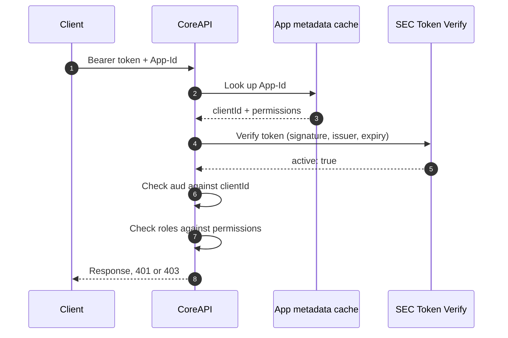

# SEC Token Verification and Per-Application Audience

CoreAPI rejected valid PlanetHCSC tokens because its local issuer check did not recognize Planet's ForgeRock issuer. Following the recommended fix, CoreAPI now verifies every token through SEC Token Verify, which resolved the issuer failure. That exposed a second failure: CoreAPI checks every token's audience against one global `CLIENT_ID`, so Planet tokens still fail. We propose checking the audience against the OAuth client configured for the app named in the `App-Id` header instead. Role-based authorization is unchanged.

## The new issue: each app has its own client ID

With SEC in place, Planet tokens pass verification but are still rejected by CoreAPI with `401 Audience doesn't match`.

In HCSC's ForgeRock, a token's `aud` claim is the client ID of the app that requested it. CoreAPI compares `aud` with a single global `CLIENT_ID`, which is DeliA's. So only DeliA tokens can pass:

| Token from | Token `aud` | CoreAPI expects | Result |
| --- | --- | --- | --- |
| DeliA | DeliA's client ID | DeliA's client ID (`CLIENT_ID`) | Accepted |
| PlanetHCSC | `a23afbdbec3c46cfa573483eeaf5ad27` | DeliA's client ID (`CLIENT_ID`) | 401 Audience doesn't match |

The token is genuine; it was simply issued to a different client. The fix is for CoreAPI to know which client ID each app uses, and check `aud` against the right one.

## Simple sequence diagram

Every authenticated request to CoreAPI goes through four checks. Steps 1 to 4 below follow the diagram.

| Step | Status |
| --- | --- |
| 1. Find the app's client ID | **New** |
| 2. SEC Token Verify | Already agreed and implemented |
| 3. Check the audience | **Changed**: per app instead of one global value |
| 4. Check the user's roles | Unchanged |



## 1. CoreAPI finds the app's client ID

The client sends two headers with every request:

| Header | Example | Purpose |
| --- | --- | --- |
| `Authorization` | `Bearer eyJ0eXAi...` | The ForgeRock access token. |
| `App-Id` | `APP00236883` | Which app the request is for. |

CoreAPI looks up the `App-Id` in its app metadata cache (an in-memory copy of the APP records in Cosmos) and reads that app's `clientId`. This uses only the header; nothing inside the token is read yet.

- If the request has no `App-Id`, CoreAPI uses the global `CLIENT_ID`, as it does today.
- If the app's record has no `clientId` yet, CoreAPI also uses the global `CLIENT_ID`.
- If the `App-Id` is not found, the request is rejected with 401.

## 2. SEC Token Verify checks the token

CoreAPI does not hold ForgeRock's public keys, so it cannot prove a token is genuine by decoding it. It sends the token to SEC Token Verify (v6) instead.

| SEC checks | Meaning |
| --- | --- |
| Signature | ForgeRock signed the token and nobody changed it. |
| Signing algorithm | The token uses an allowed algorithm. |
| Issuer (`iss`) | The token came from a ForgeRock issuer HCSC trusts. |
| Expiry (`exp`) | The token has not expired. |

CoreAPI continues only on HTTP 200 with `active: true`. Anything else (`active: false`, a non-200 status, a timeout or an unreadable response) is rejected with 401.

**This is what fixed the original issue.** CoreAPI no longer keeps its own list of issuers, so Planet's issuer (`auth-uat.hcsctest.net`) is accepted because SEC trusts it. SEC does not check the audience, which is why step 3 is needed.

## 3. CoreAPI checks the audience

CoreAPI compares the token's `aud` with the `clientId` found in step 1, instead of the global `CLIENT_ID`.

| | Before | After |
| --- | --- | --- |
| Expected `aud` | One global `CLIENT_ID` for every app | The `clientId` of the app named in `App-Id` |
| Planet token | Rejected: `401 Audience doesn't match` | Accepted when `App-Id` is Planet's |
| Planet token sent as another app | Rejected | Rejected |

This ties each token to its own app: a Planet token can act only as Planet. The expected audience always comes from CoreAPI's own metadata, never from a header the client sends.

## 4. CoreAPI checks the user's roles

This step is unchanged. CoreAPI reads the user's roles from the token and compares them with the permissions in the app's metadata for the requested path and method.

| Token type | Roles read from |
| --- | --- |
| PKCE (user login) | `roles` |
| STS | `hcsc_private_claims.roles` |

A valid token whose roles do not allow the request receives 403.

## What changes in app metadata

Each APP record in the Cosmos `platform-data` container gets one new field, `clientId`.

```json
{
  "id": "APP00236883",
  "applicationId": "PLATFORM-APPS",
  "documentType": "APP",
  "clientId": "<oauth-client-id>",
  "roles": [],
  "configurations": {}
}
```

| Field | Purpose |
| --- | --- |
| `id` | The app's ID. Clients send this as `App-Id`. |
| `clientId` | The OAuth client ID expected in the token's `aud`. Not a secret. |

To enable an app:

1. Add its `clientId` to its APP record.
2. Restart CoreAPI or refresh the metadata cache. The cache otherwise picks up changes only after its TTL.
3. Call CoreAPI with the app's `App-Id` and a token issued for that app's client.

Removing `clientId` from a record puts that app back on the global `CLIENT_ID`.

## Sample flow

A PlanetHCSC request in UAT, in call order. Tokens are shortened; user details are replaced with placeholders.

### Step 1 — Planet calls CoreAPI

- **URL:** `https://<coreapi-host>/<endpoint>`
- **Headers:** `Authorization: Bearer eyJ0eXAiOiJKV1Qi...` and `App-Id: <planet-app-id>`

The token's relevant claims, decoded:

```json
{
  "iss": "https://auth-uat.hcsctest.net:443/sso/oauth2/realms/root/realms/employees",
  "aud": "a23afbdbec3c46cfa573483eeaf5ad27",
  "client_id": "a23afbdbec3c46cfa573483eeaf5ad27",
  "scope": ["openid", "profile"],
  "roles": "basicuser;IDP_DELIA_USER",
  "sub": "<user-id>"
}
```

### Step 2 — CoreAPI finds Planet's client ID

CoreAPI reads `<planet-app-id>` from the metadata cache:

```json
{
  "id": "<planet-app-id>",
  "documentType": "APP",
  "clientId": "a23afbdbec3c46cfa573483eeaf5ad27"
}
```

### Step 3 — CoreAPI verifies the token with SEC

- **URL:** `https://t-stv-ig-uat-svc.test.hcscint.net/v6/sec-token-verify`
- **Method:** `POST`, form-encoded
- **Body:** `token=eyJ0eXAiOiJKV1Qi...` (no `Bearer` prefix)

Response (abbreviated):

```json
{
  "active": true,
  "verify_results": "success",
  "iss": "https://auth-uat.hcsctest.net:443/sso/oauth2/realms/root/realms/employees",
  "client_id": "a23afbdbec3c46cfa573483eeaf5ad27"
}
```

### Step 4 — CoreAPI checks audience and roles

| Check | Token | Expected | Result |
| --- | --- | --- | --- |
| Audience | `aud` = `a23afbdb...` | Planet's `clientId` = `a23afbdb...` | Pass |
| Roles | `basicuser`, `IDP_DELIA_USER` | Planet's permissions for the path and method | Pass or 403 |

### Before this change

The same request passed SEC but failed at the audience check, because `aud` was compared with the global `CLIENT_ID`:

```json
{
  "message": "JWT token validation failed: Audience doesn't match",
  "success": false,
  "data": {}
}
```
